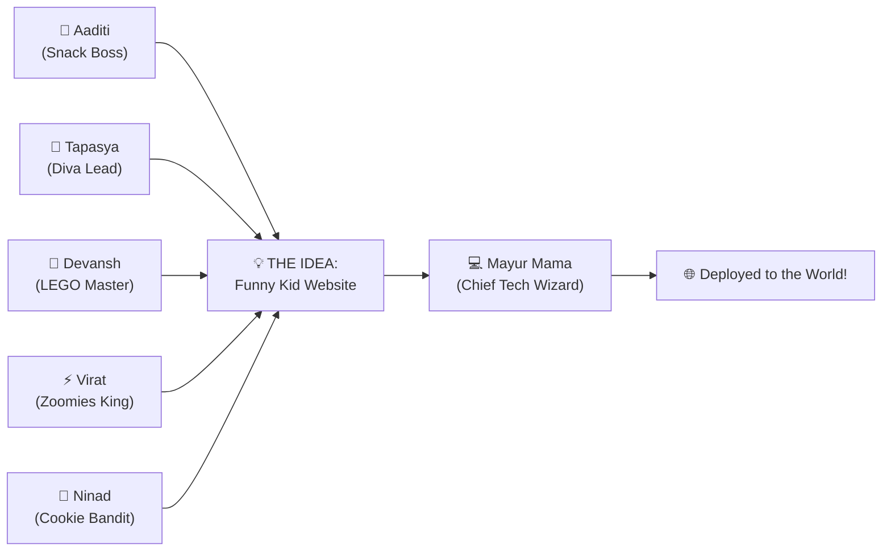
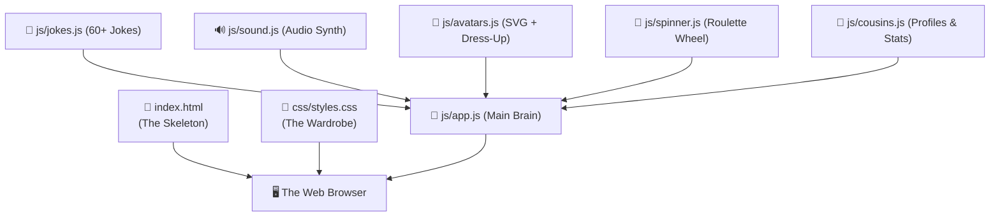
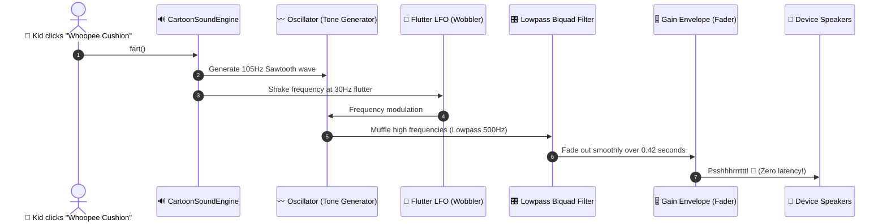
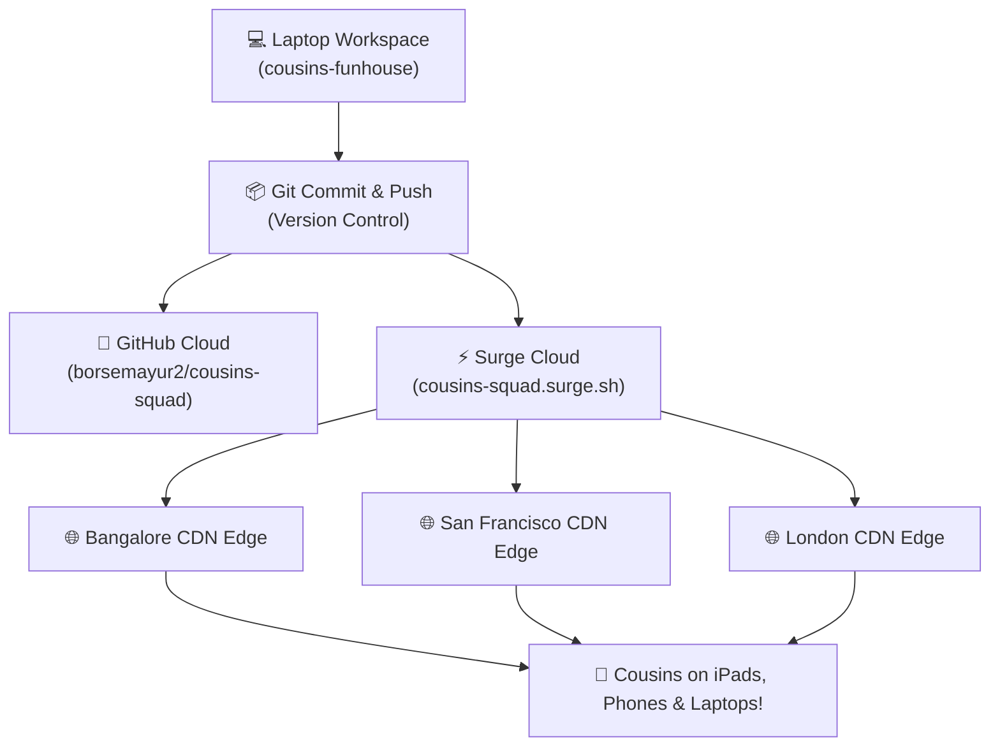

# 🚀 THE CHAOS CHRONICLES
## How Mayur Mama & The AI Built the Ultimate Cousins Website (Without Melting the WiFi)

> [!NOTE]
> **Who is this guide for?**
> Whether you're **Aaditi** inspecting the code with a clipboard, **Tapasya** singing bug fixes in dramatic high notes, **Devansh** looking for software things to take apart, **Virat** sprinting between browser tabs, or **Ninad** looking for cookies hidden inside the hard drive — this document explains **exactly how modern software development happens** from zero to cloud deployment!

---

## 🎯 1. The Genesis: What Was the Mission?

Every great software project in human history starts with a problem:
* Space travel? Need rocket software.
* Banking? Need money software.
* **The Cousins?** Needed a digital fortress to celebrate their legendary chaos, tell goofy jokes on every page reload, play cartoon fart sounds, dress up in pirate hats, and establish that Aaditi was born first.



---

## 🧠 2. The Architectural Blueprint: How Web Apps Work

Before writing a single line of code, software engineers must decide: **How will this machine actually work?**

### The Three Sacred Scrolls of the Web:
1. **HTML (`index.html`) — The Skeleton 🦴**
   * Tells the browser *what* exists on the page (a button here, an avatar there, a joke card here).
2. **CSS (`css/styles.css`) — The Wardrobe & Cosmetics 🎨**
   * Tells the browser *how* it should look (bouncy bubblegum colors, neon glow, cartoon dropshadows, rounded buttons).
3. **JavaScript (`js/*.js`) — The Brain & Muscles 🧠💪**
   * Tells the browser *what to do* when clicked (play a clown horn, calculate confetti physics, spin the roulette wheel).



> [!TIP]
> **Why Modular Code?**
> Notice how we didn't dump 5,000 lines of code into one gigantic messy file! Just like Devansh keeps his LEGO bricks in separate sorted bins (or scattered across the living room carpet to step on), software engineers keep jokes in `jokes.js`, sounds in `sound.js`, and avatars in `avatars.js`. If a joke is unfunny, you only touch `jokes.js`!

---

## 🎨 3. Avatar Alchemy: Vector Math vs. 3D Generative AI

How did we create the avatars for each cousin and Mayur Mama? We actually built **two completely different avatar systems**:

### A. The Scalable Vector Graphics (SVG) System 📐
An SVG is not a normal photo made of pixels. **It is pure geometry and math!**
* If you zoom into a regular JPEG photo 1,000 times, you see blurry little pixel blocks.
* If you zoom into an SVG avatar 1,000 times on Virat's 4K gaming monitor, **it remains razor sharp!** Why? Because the browser calculates:
  $$\text{Circle}(\text{cx}=100, \text{cy}=90, r=42)$$
  $$\text{Glasses} = \text{Rectangle}(x=70, y=76, w=24, h=18)$$

### B. The Interactive "Silly Dress-Up Lab" Engine 🥸
How does Aaditi get an Alien Antenna or Ninad get a Groucho Mustache?
When a kid clicks a hat button:
1. JavaScript intercepts the click event.
2. It fetches the cousin's base facial coordinates.
3. It dynamically welds the hat SVG geometry directly onto their head coordinate space.
4. It triggers a CSS pop-in animation:
   $$\text{scale}(0.6) \longrightarrow \text{scale}(1.05) \longrightarrow \text{scale}(1.0)$$

---

## 🔊 4. The Soundboard Engine: Making Sound Out of Pure Math

Most amateur websites download bulky `.mp3` files from external servers.
* What happens when the internet is slow? **Silence.**
* What happens if the audio server goes down? **Broken buttons.**

Instead, **Mayur Mama's website synthesizes audio from raw sound waves using the browser's Web Audio API!**

| Sound Effect | Wave Type | Frequency Equation / Trick |
| :--- | :--- | :--- |
| **🦘 Cartoon Boing** | `triangle` | Frequency sweeps rapidly from $140\text{ Hz} \to 650\text{ Hz}$, modulated by a $16\text{ Hz}$ vibrato wobble! |
| **💨 Whoopee Cushion** | `sawtooth` | Low rumble $105\text{ Hz} \to 45\text{ Hz}$ piped through a $500\text{ Hz}$ Low-Pass filter with fluttering oscillations! |
| **🎺 Clown Horn** | `dual wave` | Two harmonic frequencies ($370\text{ Hz} + 466\text{ Hz}$) struck with a sudden attack envelope! |
| **🥁 Rimshot (Ba-Dum-Tss)** | `white noise` | Generates 18,000 randomized random math values between $-1$ and $+1$ to simulate a metal cymbal vibrating! |
| **💻 Tech Beep** | `square` | Classic 8-bit retro gaming arpeggio ($E_4 \to A_4 \to C\#_5 \to E_5 \to A_5$) for Mayur Mama! |



---

## 🕵️‍♂️ 5. The Debugging Chronicles: "Many Things Not Working"

Every software engineer in Silicon Valley has uttered the sacred words:
> *"It worked on my machine... why is it broken in production?!"*

When the website was first tested, several classic real-world bugs struck. Here is the forensic investigation and how we fixed them:

### Bug Case #1: The Phantom Audio Curse (Mobile Safari Autoplay Guard)
* **The Crime**: You tap a sound button on an iPhone or iPad, and nothing happens! Total radio silence.
* **The Culprit**: Apple and Google designed mobile browsers to mute all audio by default until an explicit human finger taps the screen. If `AudioContext` is created before this touch, the browser puts it into a coma (`state = "suspended"`).
* **The Hero Fix**:
  ```javascript
  const unlockAudio = () => {
    if (window.soundFx) window.soundFx.init();
    if (soundFx.ctx.state === 'suspended') soundFx.ctx.resume();
    window.removeEventListener('pointerdown', unlockAudio);
  };
  window.addEventListener('pointerdown', unlockAudio, { passive: true });
  ```
  On the very first microsecond any human finger grazes the glass, the audio engine awakens instantly!

### Bug Case #2: The Audio Duel (Sound FX vs. Speech Synthesis)
* **The Crime**: When clicking on a cousin's card, the cartoon giggle and the robot speech narrator tried to speak at the exact same millisecond, choking the audio output.
* **The Hero Fix**:
  Introduced an asynchronous delay queue. The sound effect plays first for 250 milliseconds, giving the kid a giggle, and *then* the SpeechSynthesis voice narrates their quote with animated glowing speech bubbles!

### Bug Case #3: The Blocking Browser `alert()`
* **The Crime**: Clicking "📸 Snap Photo" triggered a classic browser `alert("CHEESE!")` popup that froze the entire browser tab and looked like software from 1998.
* **The Hero Fix**: Built a custom non-blocking floating **Kid Toast Notification** (`.kid-toast-banner`) that bounces down from the top of the viewport with Ka-Ching sound effects and confetti!

---

## ☁️ 6. Deployment: How The Code Flew Across The Globe

Writing code on a laptop is like writing a secret diary. **Deployment is printing 10 million copies and rocketing them to every continent!**



### The Two Deployed Fortresses:
1. **Surge CDN (`cousins-squad.surge.sh`)**:
   * Uses edge server points of presence in San Francisco, London, Toronto, New York, Amsterdam, Frankfurt, Singapore, and **Bangalore**.
   * When Ninad clicks reload in India, the site is served from Bangalore in under 30 milliseconds!
2. **GitHub Pages (`borsemayur2.github.io/cousins-squad`)**:
   * Backed by Fastly global caching and GitHub's distributed web network with automatic SSL encryption (`HTTPS`).

---

## 📖 7. The Tech Glossary: How Software Folks Talk

Here is a decoder ring for the cousins so they can talk like master software engineers:

* **Bug 🪲**: An error in code. Called a "bug" because in 1947, computer pioneer Grace Hopper found an *actual physical moth* stuck inside a relay of the Harvard Mark II computer!
* **Frontend 🎨**: Everything you can see, tap, hear, or throw a tomato at (HTML, CSS, JS).
* **API (Application Programming Interface) 🔌**: A digital waiter. You tell the waiter what joke you want; the waiter runs to the kitchen and brings it back to your plate.
* **Git & Commit 💾**: A magical time machine. Every commit is a permanent snapshot in time. If Devansh accidentally deletes all the CSS, one git command rolls time backward!
* **Deploy 🚀**: Taking code off your laptop and broadcasting it to servers worldwide so anyone with an internet connection can view it.
* **Cache ⚡**: Storing a copy of something nearby so you don't have to fetch it from halfway across the world every single time.
* **DOM (Document Object Model) 🌲**: The browser's live internal family tree of every button, image, and text box on the screen.

---

## 🏆 Epilogue: The Secret of Coding

Coding isn't about memorizing boring computer words.
It's about **building things that bring joy, laughter, and fun to the people you love**. 

Mayur Mama didn't just write HTML and CSS — he built a digital clubhouse where:
* Aaditi's bossiness is immortalized with a golden crown.
* Tapasya has an infinite stage to sing.
* Devansh has infinite gadgets to dismantle.
* Virat can run zoomies at Mach 3.
* Ninad can steal cookies without getting in trouble.
* And Mayur Mama has a quiet place to restart the router in peace!

**Case Closed. Long live the Chaos Cousins! 🎪💖**
